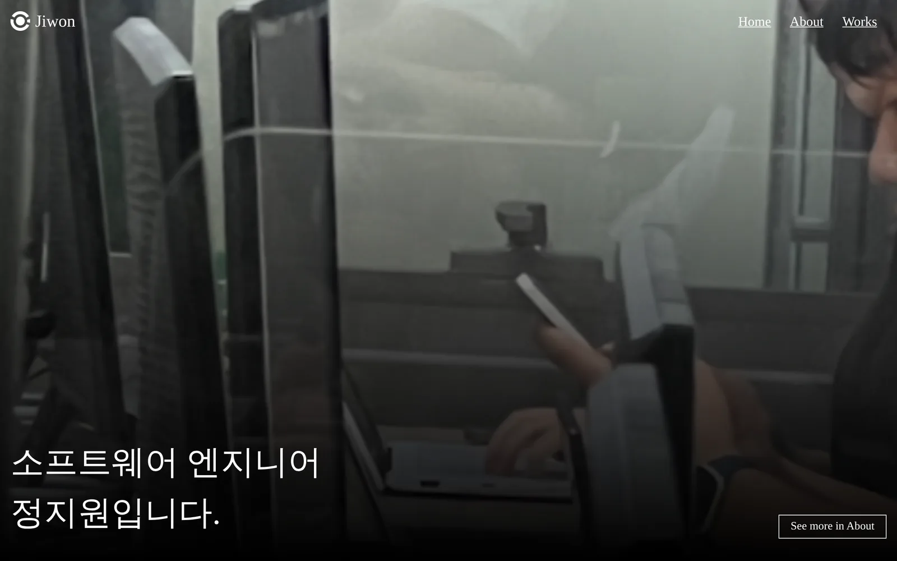

# 🧑‍💻 Jiwon-Web

**소프트웨어 엔지니어 정지원의 자기소개 웹사이트 (2세대)**

[**사이트 보기 →**](https://jiwonsudo.github.io/Jiwon-Web/)

## 구성

| 페이지 | 내용 |
|---|---|
| Home | 인트로 · 최근 작업(StoryRail, Ryak, 직촌 등) |
| About | 소개 · 이력 |
| Works | 프로젝트 목록 |
| Essay | 글 |

프레임워크 없이 HTML · CSS · JavaScript로 만들고 GitHub Actions로 GitHub Pages에 배포했습니다.

> 현재 포트폴리오는 [jiwonsudo.github.io/portfolio](https://jiwonsudo.github.io/portfolio/)에서 볼 수 있습니다.
